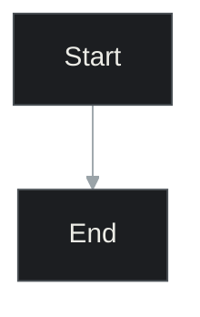
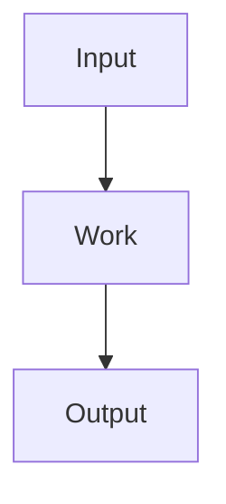
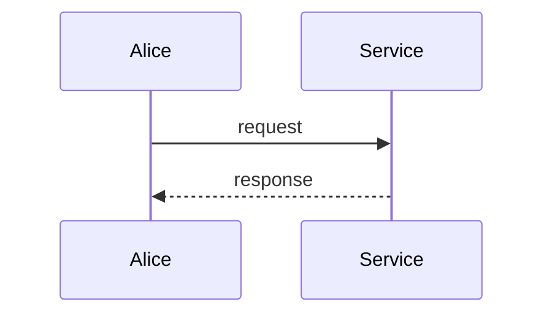
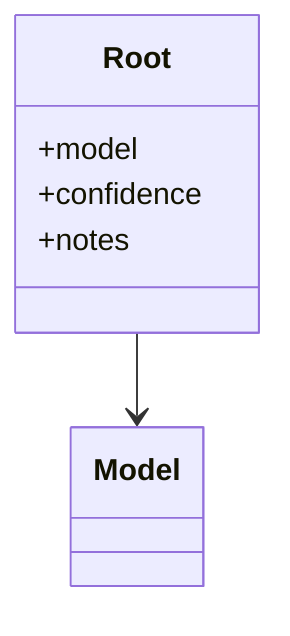

# Mermaid rules (Kroki-safe)

Kroki runs Mermaid server-side. Invalid syntax returns HTTP 400. Follow these
for **any** conversation — the samples below are syntax, not domain templates.

## Frontmatter (optional)



You may omit the frontmatter. The render script does not inject it.

## IDs and labels

```text
GOOD:  API["lookupSku()"]
GOOD:  PDF["PDF page"]
BAD:   PDF page["PDF page"]     # spaces in ID
BAD:   A[don't]                 # unquoted apostrophe
GOOD:  A["don't invent a step"]
```

- IDs: letters, digits, underscore. Start with a letter.
- Multi-line labels: `"line one<br/>line two"`
- Decision nodes: `READY{"Ready to ship?"}`
- Subgraphs: `subgraph vlm["VLM arm"]` … `end`

## Flowchart



Directions: `TB` (pipeline), `LR` (call chain).

## Sequence



## Class / contract



Prefer a small flowchart for JSON shapes if class syntax gets messy.

## Limits

- Stay under ~20 nodes per diagram. Split instead of cramming.
- Do not put raw secrets, full API keys, or PII in labels.
- Do not use HTML except `<br/>`.
- Avoid experimental diagram types unless you have verified Kroki's Mermaid version supports them.
- `mindmap` and `sankey` are version-sensitive — skip them unless you can re-render after a failure.
